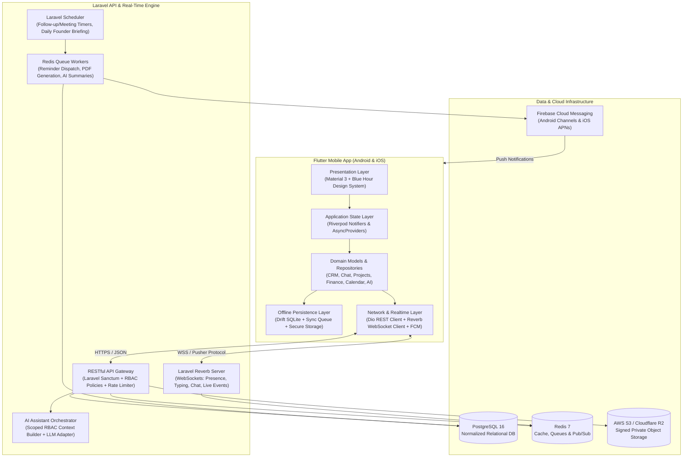

# BLUE HOUR HQ – SYSTEM ARCHITECTURE, FOLDER STRUCTURE & DATABASE SCHEMA

**Project:** Blue Hour HQ  
**Organization:** Blue Hour Creative Studios  
**Product Type:** Unified Executive & Agency Operations Mobile Platform (Android & iOS)  
**Stack:** Flutter (Material 3, Riverpod, GoRouter, Dio, Drift, fl_chart, FCM) + Laravel (Sanctum, Reverb, Redis Queues, Scheduler, Firebase Admin SDK) + PostgreSQL  

---

## 1. HIGH-LEVEL SYSTEM ARCHITECTURE



---

## 2. COMPLETE REPOSITORY FOLDER STRUCTURE

```text
BHCS_APP/
├── README.md
├── documentation/
│   ├── ARCHITECTURE_AND_SCHEMA.md        # Complete architecture, folder layout & DB schema
│   ├── API_SPECIFICATION.md              # REST & WebSocket endpoint contracts
│   └── DESIGN_SYSTEM.md                  # Blue Hour HQ UI/UX design tokens & widget guide
├── deployment/
│   ├── docker-compose.yml                # PostgreSQL, Redis, Laravel API, Reverb, Nginx
│   ├── nginx/
│   │   └── bluehour.conf
│   └── env.example
├── backend/
│   ├── app/
│   │   ├── Console/Commands/
│   │   │   ├── DispatchScheduledRemindersCommand.php
│   │   │   └── SendDailyFounderBriefingCommand.php
│   │   ├── Events/
│   │   │   ├── MessageSent.php
│   │   │   ├── MessageRead.php
│   │   │   ├── UserTyping.php
│   │   │   └── LeadStatusUpdated.php
│   │   ├── Http/
│   │   │   ├── Controllers/Api/V1/
│   │   │   │   ├── AuthController.php
│   │   │   │   ├── DashboardController.php
│   │   │   │   ├── LeadController.php
│   │   │   │   ├── LeadFollowupController.php
│   │   │   │   ├── ClientController.php
│   │   │   │   ├── ChatChannelController.php
│   │   │   │   ├── ChatMessageController.php
│   │   │   │   ├── ProjectController.php
│   │   │   │   ├── TaskController.php
│   │   │   │   ├── MeetingController.php
│   │   │   │   ├── ProposalController.php
│   │   │   │   ├── InvoiceController.php
│   │   │   │   ├── ExpenseController.php
│   │   │   │   ├── EmployeeController.php
│   │   │   │   ├── NotificationController.php
│   │   │   │   ├── AiAssistantController.php
│   │   │   │   └── GlobalSearchController.php
│   │   │   ├── Middleware/
│   │   │   │   └── EnforceRolePermission.php
│   │   │   └── Requests/
│   │   ├── Jobs/
│   │   │   ├── ProcessScheduledReminderJob.php
│   │   │   ├── SendFcmPushNotificationJob.php
│   │   │   └── GenerateProposalPdfJob.php
│   │   ├── Models/                       # Eloquent Models for all 45 PostgreSQL tables
│   │   ├── Policies/                     # Backend-enforced RBAC policies per resource
│   │   └── Services/
│   │       ├── FcmNotificationService.php
│   │       ├── ReminderSchedulerService.php
│   │       ├── LeadConversionService.php
│   │       └── AiBusinessAssistantService.php
│   └── database/
│       ├── postgresql_schema.sql         # Complete Normalized PostgreSQL DDL
│       ├── migrations/
│       └── seeders/
└── mobile_app/
    ├── pubspec.yaml
    └── lib/
        ├── main.dart
        ├── app.dart
        ├── core/
        │   ├── constants/
        │   │   └── app_constants.dart
        │   ├── theme/
        │   │   ├── app_colors.dart       # Deep Navy #10172A, Midnight #172554, Electric #3B82F6, Indigo #6366F1
        │   │   ├── app_typography.dart   # Inter & Manrope type hierarchy
        │   │   └── app_theme.dart        # Material 3 Dark & Light themes
        │   ├── router/
        │   │   └── app_router.dart       # GoRouter configuration & deep-link routes
        │   ├── utils/
        │   │   └── formatters.dart       # INR currency (₹), compact numbers, relative dates
        │   └── widgets/
        │       ├── bh_card.dart          # Elevated & glassmorphic surface cards
        │       ├── bh_status_pill.dart   # Semantic status & priority badges
        │       ├── bh_avatar.dart        # Presence-aware user & company avatars
        │       ├── bh_kpi_card.dart      # Executive metric card with sparkline/trend delta
        │       ├── bh_section_header.dart
        │       ├── bh_empty_state.dart
        │       └── main_shell_scaffold.dart # 5-tab bottom navigation + quick Command/AI trigger
        ├── data/
        │   ├── models/
        │   │   ├── user_model.dart
        │   │   ├── lead_model.dart
        │   │   ├── client_model.dart
        │   │   ├── chat_model.dart
        │   │   ├── project_model.dart
        │   │   ├── task_model.dart
        │   │   ├── meeting_model.dart
        │   │   ├── notification_model.dart
        │   │   ├── finance_model.dart
        │   │   └── ai_insight_model.dart
        │   ├── repositories/
        │   │   └── agency_data_provider.dart # Riverpod state management & realistic seeded store
        │   └── local/
        │       └── offline_sync_manager.dart # Connection status, conflict rules & sync queue
        └── features/
            ├── auth/
            │   ├── splash_screen.dart
            │   ├── onboarding_screen.dart
            │   └── login_screen.dart
            ├── dashboard/
            │   └── founder_dashboard_screen.dart
            ├── leads/
            │   ├── leads_screen.dart
            │   └── lead_detail_screen.dart
            ├── chat/
            │   ├── chat_list_screen.dart
            │   └── chat_room_screen.dart
            ├── projects/
            │   ├── projects_screen.dart
            │   └── project_detail_screen.dart
            ├── calendar/
            │   └── meeting_calendar_screen.dart
            ├── notifications/
            │   └── notification_centre_screen.dart
            ├── finance/
            │   └── finance_proposals_screen.dart
            ├── clients/
            │   └── clients_screen.dart
            ├── tasks/
            │   └── tasks_screen.dart
            ├── ai_assistant/
            │   └── ai_assistant_sheet.dart
            ├── search/
            │   └── global_search_sheet.dart
            └── profile/
                └── profile_settings_screen.dart
```

---

## 3. ROLE-BASED ACCESS CONTROL (RBAC) MATRIX

| Role | Dashboard | CRM & Leads | Clients | Internal Chat | Projects & Tasks | Meetings | Proposals | Finance & INR Invoices | Team & Admin |
| :--- | :---: | :---: | :---: | :---: | :---: | :---: | :---: | :---: | :---: |
| **1. Founder** | Full Executive | Full (All) | Full (All) | Full + Announce | Full (All) | Full (All) | Full + Approve | Full Financial | Full System |
| **2. Super Admin** | Full Executive | Full (All) | Full (All) | Full + Channels | Full (All) | Full (All) | Full + Approve | Full Financial | Full System |
| **3. Administrator** | Ops Summary | Full (All) | Full (All) | Full + Channels | Full (All) | Full (All) | Create/Edit | View Summary | Manage Users |
| **4. Sales Executive** | Sales KPIs | Assigned + Create | View Converted | Channels + DMs | View Linked | Sales/Client | Create/Send | View Client Quotes | View Directory |
| **5. Project Manager** | Delivery KPIs | View Converted | Assigned | Channels + DMs | Manage Projects | Project/Client | View Scope | Milestone Billing | Team Workload |
| **6. Developer** | Personal Tasks | None | Assigned Spec | Dev + Project | Assigned Tasks | Internal/Proj | None | None | View Directory |
| **7. Designer** | Personal Tasks | None | Brand Assets | Design + Proj | Assigned Tasks | Internal/Proj | None | None | View Directory |
| **8. Social Media Mgr**| Campaign KPIs | Social Leads | Assigned | Social + Proj | Retainer Tasks | Client/Internal| Social Quotes | None | View Directory |
| **9. Finance Manager** | Finance KPIs | View Converted | Billing Info | Channels + DMs | Budget View | Finance/Internal| Pricing Approval| Full Invoicing/Exp | Payroll/Expense |

---

## 4. NORMALIZED POSTGRESQL DATABASE SCHEMA

All tables use `UUID` primary keys (`gen_random_uuid()`), `TIMESTAMPTZ` stored in UTC, foreign key constraints with explicit `ON DELETE` rules, and composite B-Tree / GIN indexes for global search and timeline filtering.

### 4.1 User Management & RBAC (`6 Tables`)
1. `departments` (`id`, `name`, `code`, `description`, `head_user_id`, `created_at`, `updated_at`)
2. `users` (`id`, `employee_code`, `name`, `email`, `phone`, `password_hash`, `avatar_url`, `department_id`, `designation`, `joining_date`, `status`, `two_factor_enabled`, `two_factor_secret`, `founder_briefing_time`, `timezone`, `last_seen_at`, `is_online`, `created_at`, `updated_at`, `deleted_at`)
3. `roles` (`id`, `slug`, `name`, `description`, `is_system_role`, `created_at`, `updated_at`)
4. `permissions` (`id`, `module`, `action`, `slug`, `description`, `created_at`)
5. `role_permissions` (`role_id`, `permission_id`, `granted_at`)
6. `user_roles` (`user_id`, `role_id`, `assigned_by`, `assigned_at`)

### 4.2 CRM & Lead Management (`5 Tables`)
7. `lead_sources` (`id`, `name`, `slug`, `icon_name`, `is_active`, `created_at`)
8. `leads` (`id`, `lead_code`, `company_name`, `contact_person`, `phone`, `email`, `website`, `location`, `industry`, `lead_source_id`, `interested_service`, `estimated_budget_inr`, `assigned_to`, `created_by`, `priority`, `status`, `expected_closing_date`, `lost_reason`, `converted_client_id`, `converted_at`, `notes`, `last_contacted_at`, `next_followup_at`, `created_at`, `updated_at`, `deleted_at`)
9. `lead_activities` (`id`, `lead_id`, `actor_id`, `activity_type`, `title`, `description`, `metadata_json`, `created_at`)
10. `lead_followups` (`id`, `lead_id`, `assigned_to`, `created_by`, `followup_type`, `scheduled_at`, `notes`, `reminder_preferences_json`, `status`, `completed_at`, `outcome_notes`, `created_at`, `updated_at`)
11. `lead_assignments` (`id`, `lead_id`, `from_user_id`, `to_user_id`, `assigned_by`, `reason`, `assigned_at`)

### 4.3 Client Management (`2 Tables`)
12. `clients` (`id`, `client_code`, `lead_id`, `company_name`, `primary_contact_name`, `email`, `phone`, `website`, `billing_address`, `gstin`, `industry`, `services_purchased_json`, `account_manager_id`, `status`, `lifetime_value_inr`, `outstanding_balance_inr`, `notes`, `onboarded_at`, `created_at`, `updated_at`, `deleted_at`)
13. `client_contacts` (`id`, `client_id`, `name`, `designation`, `email`, `phone`, `is_primary`, `created_at`, `updated_at`)

### 4.4 Project & Task Management (`7 Tables`)
14. `projects` (`id`, `project_code`, `name`, `client_id`, `category`, `description`, `project_manager_id`, `start_date`, `deadline`, `budget_inr`, `status`, `progress_percentage`, `completed_at`, `created_at`, `updated_at`, `deleted_at`)
15. `project_members` (`id`, `project_id`, `user_id`, `role_in_project`, `allocated_hours`, `joined_at`)
16. `project_milestones` (`id`, `project_id`, `title`, `description`, `due_date`, `amount_inr`, `status`, `completed_at`, `sort_order`, `created_at`, `updated_at`)
17. `tasks` (`id`, `task_code`, `project_id`, `milestone_id`, `title`, `description`, `assigned_to`, `created_by`, `priority`, `status`, `start_date`, `deadline`, `estimated_hours`, `logged_hours`, `is_recurring`, `recurrence_rule`, `depends_on_task_id`, `completed_at`, `created_at`, `updated_at`, `deleted_at`)
18. `subtasks` (`id`, `task_id`, `title`, `is_completed`, `assigned_to`, `completed_at`, `sort_order`, `created_at`)
19. `task_comments` (`id`, `task_id`, `user_id`, `body`, `created_at`, `updated_at`)
20. `task_attachments` (`id`, `task_id`, `uploaded_by`, `file_name`, `file_path`, `mime_type`, `file_size_bytes`, `created_at`)

### 4.5 Internal Real-Time Chat (`8 Tables`)
21. `channels` (`id`, `slug`, `name`, `description`, `channel_type`, `department_id`, `project_id`, `is_private`, `is_announcement_only`, `created_by`, `created_at`, `updated_at`)
22. `channel_members` (`channel_id`, `user_id`, `role`, `is_muted`, `last_read_message_id`, `joined_at`)
23. `conversations` (`id`, `conversation_type`, `title`, `channel_id`, `last_message_id`, `last_message_at`, `created_at`, `updated_at`)
24. `conversation_members` (`conversation_id`, `user_id`, `is_pinned`, `is_muted`, `unread_count`, `last_read_at`, `joined_at`)
25. `messages` (`id`, `conversation_id`, `sender_id`, `reply_to_message_id`, `message_type`, `body`, `voice_duration_sec`, `is_pinned`, `is_edited`, `edited_at`, `created_at`, `deleted_at`)
26. `message_attachments` (`id`, `message_id`, `file_name`, `storage_path`, `mime_type`, `file_size_bytes`, `thumbnail_path`, `created_at`)
27. `message_reactions` (`id`, `message_id`, `user_id`, `emoji`, `created_at`)
28. `message_reads` (`message_id`, `user_id`, `read_at`)

### 4.6 Meetings & Calendar (`3 Tables`)
29. `meetings` (`id`, `meeting_code`, `title`, `description`, `meeting_type`, `client_id`, `lead_id`, `project_id`, `organizer_id`, `meeting_date`, `start_time_utc`, `end_time_utc`, `location`, `online_meeting_link`, `status`, `reminder_intervals_json`, `created_at`, `updated_at`)
30. `meeting_participants` (`id`, `meeting_id`, `user_id`, `external_email`, `attendance_status`, `notified_at`)
31. `meeting_notes` (`id`, `meeting_id`, `author_id`, `content`, `action_items_json`, `created_at`, `updated_at`)

### 4.7 Notifications & Automated Reminder Engine (`5 Tables`)
32. `device_tokens` (`id`, `user_id`, `device_id`, `platform`, `fcm_token`, `device_Model`, `app_version`, `is_active`, `last_registered_at`, `created_at`, `updated_at`)
33. `notifications` (`id`, `user_id`, `category`, `title`, `body`, `deep_link_route`, `entity_type`, `entity_id`, `action_buttons_json`, `is_read`, `read_at`, `created_at`)
34. `notification_preferences` (`user_id`, `lead_reminders`, `meeting_reminders`, `task_reminders`, `project_updates`, `chat_messages`, `payment_alerts`, `daily_summary`, `quiet_hours_enabled`, `quiet_hours_start`, `quiet_hours_end`, `updated_at`)
35. `scheduled_reminders` (`id`, `idempotency_key`, `target_user_id`, `reminder_category`, `source_type`, `source_id`, `offset_label`, `scheduled_for_utc`, `payload_json`, `status`, `processed_at`, `retry_count`, `error_message`, `created_at`, `updated_at`)
36. `notification_logs` (`id`, `notification_id`, `scheduled_reminder_id`, `device_token_id`, `fcm_message_id`, `delivery_status`, `response_payload`, `sent_at`)

### 4.8 Proposals & Finance Management (`6 Tables`)
37. `proposals` (`id`, `proposal_code`, `lead_id`, `client_id`, `title`, `template_name`, `services_summary`, `subtotal_inr`, `discount_inr`, `tax_percent`, `tax_amount_inr`, `total_amount_inr`, `valid_until`, `status`, `terms_and_conditions`, `pdf_storage_path`, `created_by`, `sent_at`, `responded_at`, `rejection_reason`, `created_at`, `updated_at`)
38. `proposal_items` (`id`, `proposal_id`, `service_category`, `title`, `description`, `quantity`, `unit_price_inr`, `line_total_inr`, `sort_order`)
39. `invoices` (`id`, `invoice_number`, `client_id`, `project_id`, `proposal_id`, `issue_date`, `due_date`, `subtotal_inr`, `discount_inr`, `cgst_inr`, `sgst_inr`, `igst_inr`, `total_amount_inr`, `amount_paid_inr`, `balance_due_inr`, `status`, `notes`, `pdf_storage_path`, `created_by`, `created_at`, `updated_at`)
40. `invoice_items` (`id`, `invoice_id`, `description`, `service_category`, `quantity`, `unit_price_inr`, `total_inr`, `sort_order`)
41. `payments` (`id`, `payment_code`, `invoice_id`, `client_id`, `amount_inr`, `payment_date`, `payment_method`, `transaction_reference`, `is_advance`, `recorded_by`, `notes`, `receipt_path`, `created_at`)
42. `expenses` (`id`, `expense_code`, `category`, `vendor_name`, `description`, `amount_inr`, `expense_date`, `project_id`, `submitted_by`, `approved_by`, `status`, `receipt_path`, `created_at`, `updated_at`)

### 4.9 Documents & System Governance (`5 Tables`)
43. `documents` (`id`, `title`, `category`, `entity_type`, `entity_id`, `storage_disk`, `storage_path`, `mime_type`, `file_size_bytes`, `uploaded_by`, `is_confidential`, `created_at`, `updated_at`, `deleted_at`)
44. `document_permissions` (`id`, `document_id`, `role_id`, `user_id`, `can_view`, `can_download`, `can_delete`)
45. `activity_logs` (`id`, `actor_id`, `module`, `action`, `entity_type`, `entity_id`, `summary`, `ip_address`, `created_at`)
46. `user_sessions` (`id`, `user_id`, `sanctum_token_id`, `device_name`, `platform`, `ip_address`, `last_active_at`, `revoked_at`, `created_at`)
47. `audit_logs` (`id`, `actor_id`, `event_type`, `auditable_type`, `auditable_id`, `old_values_json`, `new_values_json`, `ip_address`, `user_agent`, `created_at`)

